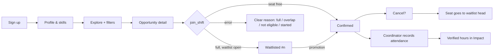
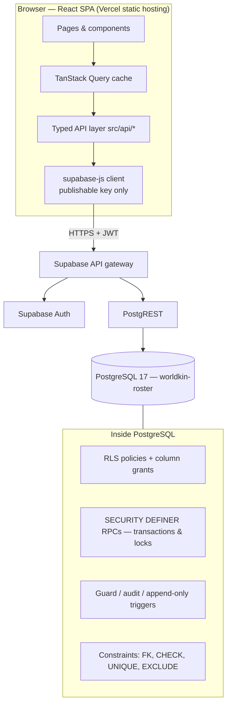

# Worldkin Roster — Consolidated Execution Blueprint

> **Status:** Planning document for owner approval. Database items are DRAFTS — nothing has been applied.
> **Companion:** [`docs/database/DATABASE_DESIGN.md`](database/DATABASE_DESIGN.md) holds the full ERD, table specs, A03/A05 design, RLS matrix, RPC specs, transaction diagrams and security test scenarios (sections 6–11 below summarize it).
> **Track:** World Problem Solver · **Advanced challenges:** A05 Concurrency & Transactions, A03 Advanced Security & Access Control

---

## 1. Verified current state (25 Nov 2026, 01:14 BDT)

| Item | Verified fact | How verified |
|---|---|---|
| Deadline | 26 Nov 2026 23:59 BDT → **≈ 46 h 45 min** remaining (calendar time, not working time) | system clock (Bangladesh Standard Time) |
| Local repo | `main` at `7657b1a`, matches `origin/main`; untracked: `docs/`, `supabase/` (drafts) | `git log`, `git ls-remote` |
| GitHub | `mdraisulislam-swe/worldkin-roster`, public, 1 commit, 19 files | earlier anonymous clone + API |
| Supabase | `worldkin-roster` / `ekkvwgohpzliwbmjnrth` / ap-southeast-1 / PG 17 / ACTIVE_HEALTHY; **public schema empty**; 0 auth users | Supabase MCP `get_project`, `list_tables` |
| Vercel | No Worldkin project exists | earlier `list_projects` |
| App | React 19, TS 7 strict, Vite 8, Tailwind 4, React Router 8; shell + Home/NotFound/RouteError; build and lint pass | Phase 0 evidence |
| SQL drafts | 4 migration files; syntax-valid under the PostgreSQL parser | `libpg-query` (syntax only) |

**Not yet true:** no table exists, no user exists, no API code, no tests, no deployment.

## 2. Product Requirements (PRD)

**Problem.** People willing to help cannot easily find trustworthy organizations, and organizations coordinate volunteers through chats and forms, which leads to overbooked or empty shifts, untracked no-shows, and volunteer hours nobody can verify.

**Who experiences it.** Volunteers (students, professionals, diaspora), NGO and community-group staff, and platform operators who must keep bad actors out.

**Solution.** A platform where only verified organizations recruit, every shift has a hard capacity with a fair waitlist, and participation hours are verified by the organization, not self-reported.

**Goals (MVP).** (1) A volunteer can find, join, cancel and track shifts end-to-end. (2) Seat allocation stays correct under concurrent load. (3) Data is isolated per organization, and verified hours cannot be forged.

**Non-goals.** Payments, chat, push or email notifications, maps and geolocation, certificates, native apps, multi-language support, field-safety operations for real conflict zones.

### Functional requirements → criteria

| ID | Requirement | Criteria |
|---|---|---|
| FR-01 | Email/password sign-up/in/out; persistent session; protected routes | M03 |
| FR-02 | Profile: name, country, city, bio, skills | M01, M02 |
| FR-03 | Organization onboarding (pending) → platform-admin review (verify/reject/suspend with reason) | M01, M04, A03 |
| FR-04 | Org team: org_admin / coordinator; consent-based email invites (no user enumeration); remove members; last-admin protection | M03, A03 |
| FR-05 | Opportunity CRUD with lifecycle draft→published→closed; remote/onsite/hybrid; skills, requirements, sensitive flag | M01, M02, M04 |
| FR-06 | Shift CRUD with capacity, waitlist limit; time frozen after signups | M02, M04 |
| FR-07 | Discovery: full-text search, filters (cause, country, mode, date, only-open), 4 sorts, pagination | M05 |
| FR-08 | Join shift → confirmed / waitlisted / rejected, idempotent, no overlaps, skill eligibility | M04, M06, A05 |
| FR-09 | Cancel (volunteer or staff with reason) + automatic FIFO waitlist promotion | M04, A05 |
| FR-10 | Capacity change (never below confirmed; promotes on increase); cancel whole shift | M04, A05 |
| FR-11 | Roster (minimal PII) + attendance (attended/no-show, hours) with no self-verification | M04, A03 |
| FR-12 | Volunteer "My shifts" + impact (verified hours, by cause) | M05 |
| FR-13 | Org dashboard: fill rate, verified hours, no-show rate, upcoming load | M05 |
| FR-14 | Audit history: org admin (own org), platform admin (all) | A03 |
| FR-15 | Validation, clear errors, retry, loading/empty/success states | M06, M07 |
| FR-16 | Responsive layout + keyboard accessible | M07 |
| FR-17 | Live deployment + README/setup docs | M08 |

**Non-functional:** strict TypeScript; no service-role key in the browser; every write path authorized in the database; p95 page interactions < 1 s on demo data; WCAG AA contrast; zero secrets in the repository.

## 3. Personas and journeys

| Persona | Goal | Key journey |
|---|---|---|
| **Amina — Volunteer** (university student) | Help on weekends, prove her hours | Sign up → profile + skills → Explore (filter "education", "only open") → opportunity → join shift → sees *Confirmed* or *Waitlist #2* → may cancel → after shift sees verified hours in Impact |
| **Rafiq — Org Admin** (NGO lead) | Recruit reliably | Create org (pending) → waits for review → after verification adds coordinator → publishes opportunity |
| **Lena — Coordinator** | Run shifts | Create shifts with capacity → watch roster/waitlist → raise capacity (auto-promotion) → mark attendance and hours |
| **Platform Admin** | Keep platform trustworthy | Review queue → verify / reject / suspend with reason → audit log |

## 4. MVP prioritization

| Priority | Features |
|---|---|
| **P0 (launch-critical)** | FR-01…FR-03, FR-05…FR-09, FR-11, FR-12 (basic), FR-13 (basic), FR-15…FR-17, all of A03/A05 database layer |
| **P1 (important)** | FR-04 member management UI, FR-10 capacity/cancel-shift UI, FR-14 audit viewer UI, search relevance sort, impact by cause |
| **P2 (optional)** | Sensitive-opportunity banner polish, CSV export, profile avatars |
| **Future** | Notifications, messaging, maps, certificates, i18n, correction workflow for hours, skills taxonomy table, native app |

Why: all 40 advanced-challenge marks and most M04 marks live in the database layer, which is P0 and gets built first. P1 items have a database fallback (for example, members can be seeded and the audit log shown in SQL), so dropping their UI does not break correctness.

## 5. System architecture

| Layer | Decision | Trade-off |
|---|---|---|
| Frontend | SPA; feature folders `pages/`, `components/`, `api/`, `lib/`, `hooks/` | No SSR (not needed for judging); simpler deploy |
| Server state | TanStack Query (cache, retries, loading/error states) | One dependency instead of hand-written state code |
| Validation | Zod schemas shared by forms; DB constraints remain authoritative | Two layers, but the client layer is only for UX |
| Business logic | PostgreSQL RPCs, not a Node backend | Only the DB gives true atomicity; no extra server to deploy |
| Errors | RPCs raise `WK_*` codes → `lib/errors.ts` maps to messages | Stable contract between DB and UI |
| Types | Generated from the live schema (`generate_typescript_types`) | Requires migrations applied first |
| Auth | Supabase email/password; session in supabase-js storage; `ProtectedRoute` guards; DB re-checks everything | UI guards are convenience only |

**Planned dependencies (added only at M2, each justified):** `@supabase/supabase-js` (API client), `@tanstack/react-query` (server state), `zod` (validation), `react-hook-form` + `@hookform/resolvers` (accessible forms with less code), `vitest` (unit and integration tests). No UI kit: components are built on Tailwind tokens, to avoid a generic look and dependency weight.

## 6–11. Database, A03, A05, RLS, RPC (summary)

Full detail: [`docs/database/DATABASE_DESIGN.md`](database/DATABASE_DESIGN.md).

- **9 tables:** profiles, organizations, org_members, org_invites, opportunities, shifts, signups, participation_records, audit_logs. Skills are an array column; attendance is a signup status plus an immutable participation record.
- **A05:** shift row lock (`FOR UPDATE`) serializes seat decisions; FIFO `queue_seq`; idempotency key UNIQUE; partial UNIQUE stops duplicate active signups; GiST **exclusion constraint** stops overlapping commitments even across different shifts; cancel, promotion and capacity changes are each one transaction; lock order shift→signup prevents deadlocks.
- **A03:** five layers — column grants → RLS → definer RPCs (only write path) → guard triggers → constraints. No API role can write `platform_role`, org status, capacity, signups, participation records or audit logs directly. Self-verification is blocked by RPC **and** a CHECK constraint. Audit and participation tables are append-only even for RPCs. Platform admins cannot review their own organization.
- **Migration sequence:** `wk01` types and tables → `wk02` helpers, triggers and audit → `wk03` RLS and grants → `wk04` RPCs and function grants. Each is applied separately, so a failure points to one file.

## 12. UI/UX information architecture

| Area | Route | Purpose | Access |
|---|---|---|---|
| Public | `/` | value proposition, featured opportunities, how it works | all |
| | `/explore` | search + filters + sort + pagination | all |
| | `/opportunities/:id` | details, requirements, shifts with live seat counts, join | all (join: signed-in) |
| | `/signin`, `/signup` | auth | guests |
| Volunteer | `/me` | upcoming, waitlisted, past shifts; cancel; impact stats | signed-in |
| | `/me/profile` | profile and skills | signed-in |
| Organization | `/orgs/new` | onboarding form | signed-in |
| | `/org/:orgId` | dashboard (metrics, upcoming shifts) | members |
| | `/org/:orgId/opportunities[/new\|/:oppId]` | opportunity CRUD + shifts | members |
| | `/org/:orgId/shifts/:shiftId` | roster, waitlist, capacity, attendance | members |
| | `/org/:orgId/team` | members (P1) | org admin |
| | `/org/:orgId/audit` | audit history (P1) | org admin |
| Admin | `/admin` | organization review queue | platform admin |
| | `/admin/audit` | global audit (P1) | platform admin |

**Navigation:** top bar (logo, Explore, My shifts, org switcher when the user is staff, Admin when platform admin, account menu); it collapses into a menu below 768 px. Skip-link and visible focus ring are already in place.

**Visual direction:** calm and editorial rather than "dashboard". Deep teal brand (`#0f5e57`), warm neutral surface, ink text, a single accent per status (confirmed = green, waitlisted = amber, cancelled = grey, no-show = rose), each always paired with a text label. System font stack, 4-px spacing scale, 8-px radius, light borders instead of heavy shadows, generous line length limits (~70ch).

**State patterns:** skeletons for lists; empty states with the next action ("No shifts yet — create the first shift"); inline field errors with `aria-describedby` and `aria-invalid`; form-level error summary; toast region with `aria-live="polite"`; confirm dialogs for destructive actions (cancel, capacity reduce, attendance); every network error offers **Retry**.

## 13. Component and page inventory

| Group | Components |
|---|---|
| Layout | `AppShell` ✓ (exists), `TopNav`, `MobileMenu`, `PageHeader`, `Container` |
| Primitives | `Button` (variants, loading), `TextField`, `TextArea`, `Select`, `Checkbox`, `TagInput` (skills), `FormField` (label + hint + error) |
| Feedback | `Toast`/`ToastRegion`, `Alert`, `Skeleton`, `EmptyState`, `ErrorState` (+retry), `ConfirmDialog` |
| Data | `StatusBadge`, `CapacityMeter`, `StatTile`, `DataTable`, `Pagination`, `FilterBar` |
| Domain | `OpportunityCard`, `ShiftRow` (join/cancel), `RosterTable`, `AttendanceForm`, `OrgReviewCard`, `ImpactSummary` |
| Routing | `ProtectedRoute` (session/role), `RouteErrorPage` ✓, `NotFoundPage` ✓ |
| Infrastructure | `lib/supabase.ts`, `lib/env.ts` (validated env), `lib/errors.ts` (WK code map), `api/*.ts`, `hooks/useSession`, `types/database.ts` (generated) |

**Pages (14):** Home, Explore, OpportunityDetail, SignIn, SignUp, MyShifts, Profile, OrgCreate, OrgDashboard, OrgOpportunities, OpportunityEditor (+shifts), ShiftManage, AdminReview, plus NotFound. P1: OrgTeam, OrgAudit, AdminAudit.

## 14. QA and test plan

| Level | Tool | Scope | Automated |
|---|---|---|---|
| Unit | Vitest | zod schemas, `errors.ts` mapping, formatters, capacity math helpers | ✅ |
| DB / RPC / RLS | Vitest + supabase-js against **Worldkin project only**, with real test users (2 orgs, coordinators, volunteers, 1 platform admin) | C1–C11, S1–S16 from DATABASE_DESIGN §9 | ✅ |
| Concurrency | same harness, `Promise.all` of N parallel RPCs, invariant checks after each run, repeated ×3 | C1–C3, C5, C9 | ✅ |
| Advisors | Supabase security + performance advisors after each migration | RLS gaps, missing indexes | ✅ (tool) |
| Functional E2E | manual checklist in the browser pane per journey (§3) | volunteer, org, admin journeys | Manual, screenshots |
| Responsive/a11y | 375 / 768 / 1280 px; keyboard-only run; contrast check | all P0 pages | Manual |
| Build | `npm run build`, `npm run lint`, `tsc` | every milestone | ✅ |
| Production smoke | live URL: sign in → explore → join → cancel → org dashboard | after production deploy | Manual |

**Traceability:** `docs/TESTING.md` will hold one row per requirement: *Requirement → Acceptance criterion → Implementation (file/function) → Test ID → Actual result → Evidence (command output / screenshot, timestamp)*. Results are recorded only from real runs.

**Test-data hygiene:** test users use a dedicated test email domain; test organizations are prefixed `[TEST]`; demo seed data is separate from test data.

## 15. Vercel deployment plan (requires separate approval)

1. Pre-checks: team = Eleventh Cipher; no project named `worldkin-roster` exists; repo = `mdraisulislam-swe/worldkin-roster`.
2. Create a **new** project `worldkin-roster`: framework Vite, build `npm run build`, output `dist`, Node 24.
3. Add `vercel.json` with an SPA rewrite (all routes → `index.html`).
4. Environment variables (Preview and Production set separately): `VITE_SUPABASE_URL=https://ekkvwgohpzliwbmjnrth.supabase.co`, `VITE_SUPABASE_PUBLISHABLE_KEY=<Worldkin publishable key>`. No secret or service-role key anywhere.
5. Preview deployment → smoke test → owner approval → production deployment.
6. Supabase Auth URL configuration: Site URL and redirect URLs = Worldkin production/preview domains (Auth change → approval).
7. Verification record: project ID, team, repo link, env var names (values never printed), deployment URL, the commit SHA deployed = GitHub `main`.
8. Rollback: promote the previous Vercel deployment; database changes are forward-only migrations.

## 16. Documentation plan

The 13 requested documents are consolidated into 8 files so that judges can find things quickly:

| File | Covers |
|---|---|
| `README.md` | overview, track, challenges, live URL, quick start, architecture summary, test access note |
| `docs/BLUEPRINT.md` (this) → final `docs/PRD.md` | PRD, personas, journeys, prioritization |
| `docs/ARCHITECTURE.md` | system architecture, security design, API/RPC reference |
| `docs/database/DATABASE_DESIGN.md` | schema, ERD, RLS, transactions |
| `docs/TESTING.md` | strategy + recorded results + evidence |
| `docs/SETUP.md` | local setup, environment guide, deployment guide |
| `docs/DEMO_SCRIPT.md` | video and live-demo script (problem → workflow → A05 → A03 → edge case) |
| `docs/SUBMISSION_CHECKLIST.md` | the four deliverables, required fields and final checks |
| **`Worldkin_Roster_Documentation.pdf`** (submission deliverable #4) | one PDF compiled from README + PRD + architecture/security + database + testing evidence + setup + known limitations; generated in M6 from the final, verified Markdown, so it matches the deployed build |

**Submission deliverables (4):** (1) YouTube presentation, (2) public GitHub repository, (3) working live project, (4) Project Documentation PDF. The official problem statement PDF lists three links (S01–S03); the fourth deliverable comes from the owner's latest submission instructions and is treated as mandatory.

## 17. Deadline-aware roadmap (times BDT; checkpoints, not promises)

| Milestone | Target | Work | Exit evidence |
|---|---|---|---|
| **M1 — Database live and proven** | 25 Nov ~10:00 | apply wk01–04 · advisors · auth setting · test users · admin bootstrap · demo seed · A03/A05 test harness | all C/S tests green ×3, advisor report, TESTING.md rows |
| **M2 — App core and volunteer flows** | 25 Nov ~20:00 | deps · env/client/error layer · generated types · auth pages · Explore · Opportunity detail · join/cancel · My shifts · Profile | build/lint/unit pass; journey checklist with screenshots |
| **M3 — Organization and admin flows** | 26 Nov ~08:00 | org onboarding · admin review · opportunity/shift editor · shift manage (roster, capacity, attendance) · dashboards | journeys 2–4 pass |
| **M4 — Deployment (preview)** | 26 Nov ~10:00 (can start right after M2) | new Vercel project · env vars · preview deploy · auth URLs | preview smoke test |
| **M5 — Hardening and production** | 26 Nov ~16:00 | responsive/a11y pass · edge cases · docs · production deploy · production smoke | live URL works; docs match behaviour |
| **M6 — Submission** | **code freeze 18:00**, submit by ~22:00 | demo video · README final · **Project Documentation PDF** · submission form | all four deliverables verified in a private window (see `docs/SUBMISSION_CHECKLIST.md`) |

**Cut order if behind (first to drop):** audit viewer UIs → team management UI (seed via SQL) → cancel-shift UI → impact by cause → relevance sort → sensitive-flag polish. **Never cut:** RLS, RPC correctness, A03/A05 tests, deployment, README.

## 18. Risk register

| # | Risk | L | I | Mitigation |
|---|---|---|---|---|
| R1 | Time runs out (solo, ~46 h incl. rest) | H | H | strict P0; cut order; approvals batched per milestone |
| R2 | Approval latency stalls work | M | H | one consolidated approval per milestone (§19) |
| R3 | SQL drafts have semantic errors (only syntax-checked) | M | M | apply file by file; fix forward with new migrations; tests catch behaviour |
| R4 | Supabase built-in email limits block confirmation mails for open self-registration | H | M | **Email confirmation stays ON** (no weakening of production auth). Judges get pre-confirmed demo accounts privately; demo/test users are created pre-confirmed via the Auth Admin API (secret key only in the owner's terminal session) or the Dashboard. Custom SMTP is an optional later decision |
| R5 | Admin-API user creation needs the secret key | M | M | the owner sets it as a session-only environment variable; it is never written to a file, the repo, or chat |
| R6 | RLS mistake leaks data | M | H | automated S-tests + Supabase advisors |
| R7 | Wrong infrastructure targeted | L | Critical | pre-op target checks; hard stops (isolation policy) |
| R8 | Vercel env misconfiguration (blank app) | M | H | `lib/env.ts` fails loudly with a clear message; preview before production |
| R9 | Free project paused during judging | L | H | activity before submission; note in README |
| R10 | Demo video takes longer than planned | M | M | script written in M5; record the A05 test run as evidence |
| R11 | Secrets leak into the public repo | L | Critical | `.gitignore`, pre-commit secret scan before each push |

## 19. Milestone approval requirements

| Milestone | Owner approval needed for |
|---|---|
| M1 | (a) apply migrations wk01–04 to `ekkvwgohpzliwbmjnrth` + run read-only checks and advisors; (b) Auth hardening only: minimum password length 8 (email confirmation stays ON); (c) create pre-confirmed test + demo users (Admin API with a session-only secret key, or Dashboard by the owner); (d) promote the owner's account to `platform_admin` with the guarded procedure in DATABASE_DESIGN.md; (e) insert demo seed data as operator; (f) run live behavioural + concurrency tests; (g) local commits (push only on the owner's word) |
| M2 | add runtime dependencies listed in §5; commits; push to `main` |
| M3 | commits; push (and any follow-up fix migration, if needed) |
| M4 | create Vercel project; set env vars; preview deploy; Supabase Auth redirect URLs |
| M5 | production deploy |
| M6 | final README, Project Documentation PDF, YouTube upload (owner), submission form (owner) |
