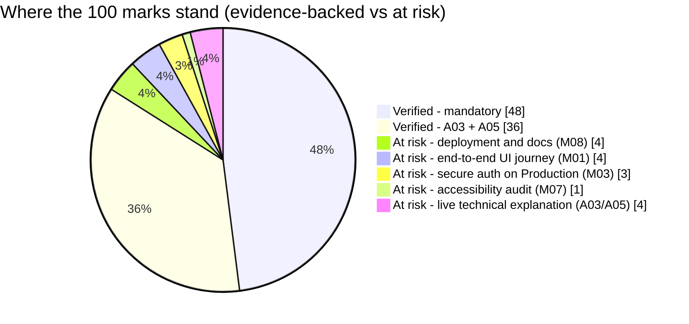
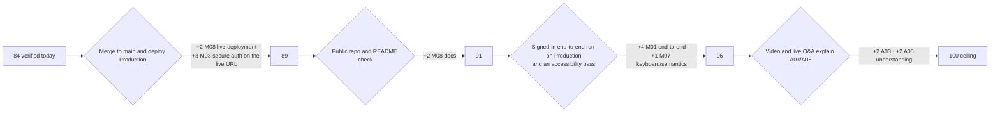

# HACK THE VIBE 2026 — scorecard and progress

**Updated:** 27 Nov 2026, after the Preview release of `2dfe9c5`.

| Item | Value |
|---|---|
| Rubric | Official PDF: M01–M08 = 60, plus two declared advanced challenges × 20 = 40 |
| Declared challenges | **A03** Advanced Security & Access Control, **A05** Concurrency & Transaction Management |
| Track | World Problem Solver |

> **This is a self-assessment, not a judge score.** Judges test live behaviour and may use hidden tests and questions.

## How marks are counted here (no invented partial marks)

The PDF splits every criterion into fixed sub-components, for example M01 = 6 + 4 + 2. Each sub-component gets one status:

| Status | Meaning | Marks counted |
|---|---|---|
| ✅ **VERIFIED** | Recorded evidence exists (live database runs, a browser check on Preview, or tests) | full sub-component marks |
| 🟡 **PARTIAL** | Built, but part of the requirement lacks evidence or a judge could not reach it yet | **0** (shown as *at risk*) |
| ⛔ **BLOCKED** | Needs your approval, content or access | **0** (at risk) |
| ❔ **NOT VERIFIED** | Cannot be evidenced before judging (for example the live explanation) | **0** (at risk) |

**Floor:** the evidence-backed score counts VERIFIED marks only.
**Ceiling:** the maximum if every at-risk item is completed and the judges agree. Nothing in between is guessed.

## Headline

| | Evidence-backed (floor) | At risk | Maximum |
|---|---|---|---|
| Mandatory M01–M08 | **48** | 12 | 60 |
| Advanced A03 + A05 | **36** | 4 | 40 |
| **Total** | **84 / 100** | **16** | 100 |



### Progress by criterion (█ = verified mark, ░ = at-risk mark)

```
M01 Functional system   ████████░░░░   8 / 12
M02 Database            ████████       8 / 8
M03 Authentication      █████░░░       5 / 8
M04 Business logic      ██████████    10 / 10
M05 Dynamic data        ██████         6 / 6
M06 Error handling      ████████       8 / 8
M07 Responsive / a11y   ███░           3 / 4
M08 Deploy & docs       ░░░░           0 / 4
A03 Security            ██████████████████░░  18 / 20
A05 Concurrency         ██████████████████░░  18 / 20
```



## Criterion by criterion

### M01 Complete functional system — 12 → **8 verified**

| Sub-component (marks) | Status | Evidence | Missing / next action |
|---|---|---|---|
| 3 interconnected modules (6) | ✅ | Volunteer, organization and admin modules share applications → offers → shifts → attendance → record. **Live DB:** `docs/evidence/live_wk06/apps_run1–3.txt` (21/21 each, organization and volunteer actions). **Preview, real session (27 Nov):** volunteer and admin routes PASS | — |
| End-to-end workflow (4) | 🟡 | The workflow passes end to end through the live API (apps runs ×3); a browser run is not recorded | One signed-in browser run on Production: apply → offer → accept → attend, with a demo organization admin account |
| Meaningful features (2) | ✅ | Verification, compensation types, capacity/waitlist, passport and certificates, map of live listings (Preview smoke 27 Nov) | — |

### M02 Database integration & persistence — 8 → **8 verified**

| Sub-component | Status | Evidence |
|---|---|---|
| CRUD (4) | ✅ | Local 99/99 and 96/96 suites; live apps runs ×3 |
| Persistent storage (2) | ✅ | Supabase Postgres; live database = repository migrations wk01–wk07 |
| Relationships & consistency (2) | ✅ | 17 tables, foreign keys, partial-unique and exclusion constraints (read-only SQL audit) |

### M03 Authentication & authorization — 8 → **5 verified**

| Sub-component | Status | Evidence | Missing / next action |
|---|---|---|---|
| Secure authentication (3) | 🟡 | Sign-in, 6-digit code and password reset work on **Preview** (owner, 27 Nov); unit tests for password rules | **Production `e616aad` lacks the reset fix** and the sign-up email is still link-first → merge, and paste the code-only email template |
| Role / resource authorization (3) | ✅ | Live security run L1–L18 PASS (`live_wk06/security.txt`); `/admin` and `/me` redirect to sign-in when signed out (Preview, 27 Nov) | L19 (Founder) skipped — optional |
| Session & access protection (2) | ✅ | Route guards (unit tests and Preview check); sign-out everywhere after reset (unit test) | — |

### M04 Complex business logic — 10 → **10 verified**

| Sub-component | Status | Evidence |
|---|---|---|
| Rule-based decisions (4) | ✅ | Organization verification state machine, selection modes, offer expiry (apps L2–L10) |
| Multi-condition workflows (4) | ✅ | Application → offer → accept → sign-up; waitlist promotion (A05 C1–C4 ×6) |
| Correct outcomes (2) | ✅ | All live runs PASS |

### M05 Dynamic data processing — 6 → **6 verified**

| Sub-component | Status | Evidence |
|---|---|---|
| Search, filter, sort (3) | ✅ | Explore filters, clear, back, country (browser, real data); map country filter (Preview 27 Nov) |
| Calculations / aggregation (2) | ✅ | `platform_stats` counts, verified hours, seat % (`seatStats` tests 10/20 = 50 %, 20/20 = full) |
| Output accuracy (1) | ✅ | Preview event "0 of 8 seats confirmed · 8 seats left" matches `shift_availability` |

### M06 Error & edge-case handling — 8 → **8 verified**

| Sub-component | Status | Evidence |
|---|---|---|
| Input validation (3) | ✅ | zod schemas + unit tests (forms, emergency schema, password rules) |
| Duplicate actions (2) | ✅ | Live: 5 parallel applications → 1; triple accept → 1 sign-up |
| Failure handling & recovery (3) | ✅ | `net.ts` timeouts and error mapping (unit tests); error states with Retry; map tile-error, geolocation-denied and invalid-video states (browser) |

### M07 Responsive UI & accessibility — 4 → **3 verified**

| Sub-component | Status | Evidence | Missing / next action |
|---|---|---|---|
| Mobile / desktop responsiveness (2) | ✅ | Sweeps at 375 / 390 / 820 / 1024 / 1440 px, 0 overflow (40 + 45 checks) | — |
| Keyboard & semantics (1) | 🟡 | One `h1` / `main` per page, labelled controls, keyboard tabs (tests) — but **no automated audit** | One axe / Lighthouse accessibility pass on Production |
| Validation & feedback (1) | ✅ | Field errors, status alerts, honest "not sent" / "not published" states |

### M08 Deployment & documentation — 4 → **0 verified**

| Sub-component | Status | Evidence | Missing / next action |
|---|---|---|---|
| Accessible live deployment (2) | ⛔ | Production `https://worldkin-roster.vercel.app` is public but runs **`e616aad`** (old). The Preview has the current code but **asks for a Vercel login** in a clean browser, so judges cannot use it | Merge `feature/applications-platform` → `main` (**your approval**) |
| Repository & setup docs (2) | 🟡 | README with setup, env names, architecture, tests, track; `docs/` and evidence | **Repository public visibility not verified**; confirm the README matches the final build |

**Mandatory subtotal: 8 + 8 + 5 + 10 + 6 + 8 + 3 + 0 = 48 / 60**

### A03 Advanced security & access control — 20 → **18 verified**

| Component (marks) | Status | Evidence |
|---|---|---|
| Implementation (8) | ✅ | RLS on 17/17 tables, 28 policies, SECURITY DEFINER RPCs with a fixed `search_path`, private documents bucket, audit log, no self-review, admins cannot suspend admins |
| Complex scenarios (6) | ✅ | **Official test — "a user tries to modify another user's restricted record":** direct writes denied (S1–S4), cross-organization isolation (L11, L15, L18), live L1–L18 PASS |
| Reliability & quality (4) | ✅ | Repeatable scripted runs; security advisor 0 ERROR |
| Technical understanding (2) | ❔ | Judged from the video and live questions — record the video using `docs/DEMO_SCRIPT.md` §7 |

### A05 Concurrency & transaction management — 20 → **18 verified**

| Component (marks) | Status | Evidence |
|---|---|---|
| Implementation (8) | ✅ | `_join_shift_core` row lock + capacity check, FIFO waitlist, idempotency-key unique index, atomic `accept_offer` |
| Complex scenarios (6) | ✅ | **Official test — "multiple users request the final available resource":** last seat → 1 confirmed + 1 waitlisted, ×3 (apps C1–C2); A05 C1–C4 ×6 |
| Reliability & quality (4) | ✅ | 3 + 6 + 3 recorded live runs, all PASS |
| Technical understanding (2) | ❔ | Video and live Q&A (`DEMO_SCRIPT.md` §6) |

**Advanced subtotal: 18 + 18 = 36 / 40 · Total evidence-backed: 48 + 36 = 84 / 100**

## Why the earlier estimate said 88–99.5 (and its arithmetic error)

- **Different method.** The earlier estimate gave partial credit inside each sub-component (for example "2.5 of 3" for secure auth). It also **assumed** that Production would be updated, the repository made public and the video submitted. This version counts only what the evidence proves today, so it is lower (84) but defensible.
- **Arithmetic error, now corrected.** The earlier low values were M01 10.5, M02 7.5, M03 7, M04 9.5, M05 5.5, M06 7.5, M07 3.5 and M08 2.5. They sum to **53.5**:
  - the scorecard printed 51.5 (total 86.5) — **wrong**;
  - `FINAL_IMPLEMENTATION_REPORT.md` printed ≈ 53 (total ≈ 88) — **rounded down**;
  - the correct earlier range was **88.5–99.5** (53.5–59.5 plus 35–40).
- **Reconciliation:** 84 (verified) + 16 (at risk) = 100. The earlier 88.5 low already counted about 4.5 of the at-risk marks, through assumed production and video items, as earned.

## Feature completion (separate from marks)

| Area | Status |
|---|---|
| Core platform: auth, organizations, opportunities, applications, offers, shifts, attendance, passport, admin | ✅ Verified (live database + Preview) |
| Prototype fidelity | 33/45 screens matched · 5 partial · 7 blocked, not implemented or reference |
| Real world map (Leaflet / OpenStreetMap) | ✅ Verified on Preview (tiles, clusters, Bangladesh, privacy) |
| Emergency Volunteer Call | 🟡 UI verified; database is a **proposal, not applied** (32/32 local checks) |
| Video player | 🟡 Component verified; **no official video URLs** |
| Organization branding, event detail and capacity, country search, footer | ✅ Verified on Preview |

## Submission requirements (gating, no marks)

| Requirement | Status |
|---|---|
| S01 YouTube video (problem, workflow, A03 + A05, one edge case) | ⛔ Not recorded — script ready |
| S02 Public GitHub repository + README | 🟡 Repository exists; **public visibility not verified** |
| S03 Live URL matching the repository | ⛔ Production = `e616aad`; current code only on a login-protected Preview |
| Track and challenge IDs declared | ✅ README: World Problem Solver; A03 + A05 |

## Highest-priority next actions

1. **Approve a PR `feature/applications-platform` → `main`, then the Production deploy.** Up to +5 (M08 live deployment, M03 secure auth). Also fixes S03.
2. **Make the GitHub repository public and recheck the README.** Up to +2 (M08 docs). Fixes S02.
3. **Record the video** using `docs/DEMO_SCRIPT.md`, including the A03 and A05 tests. Up to +4 (understanding). Fixes S01.
4. **One signed-in end-to-end browser run on Production** with demo accounts, plus one accessibility pass. Up to +5 (M01, M07).
