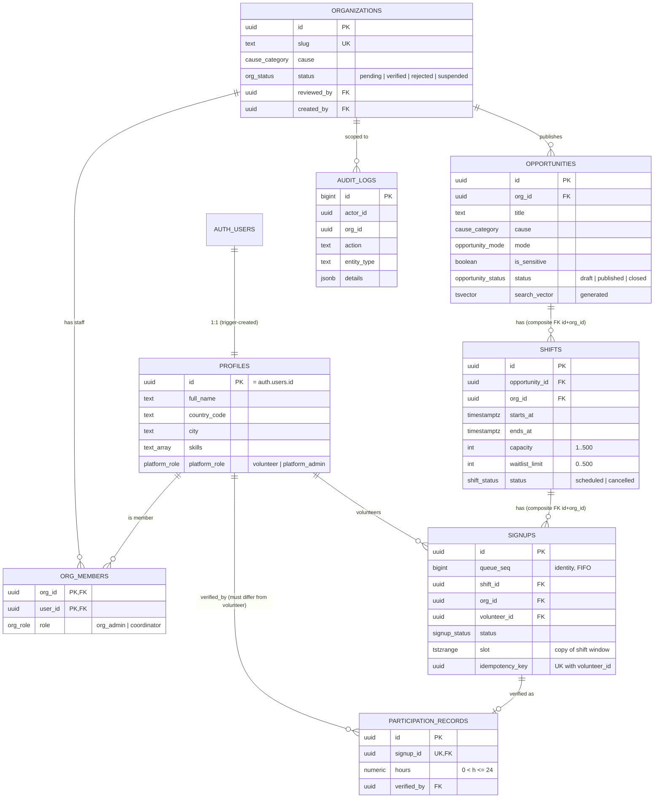
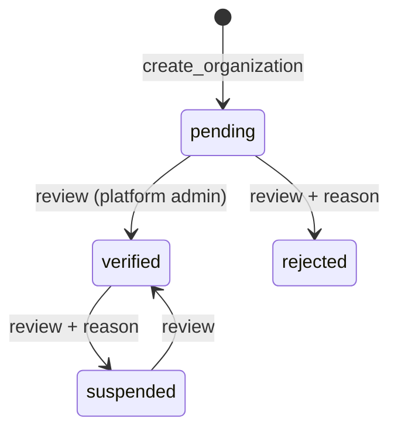
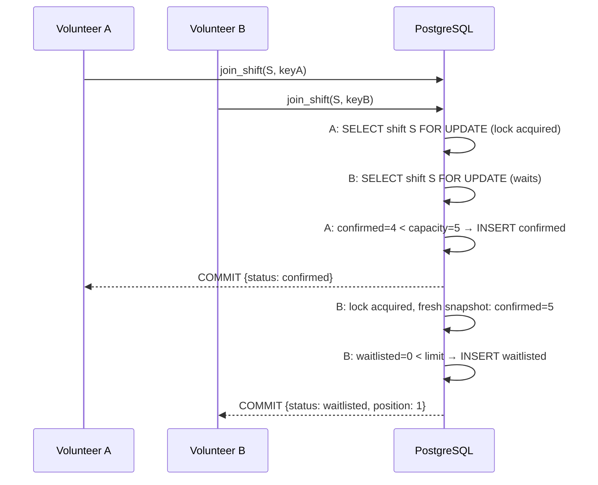
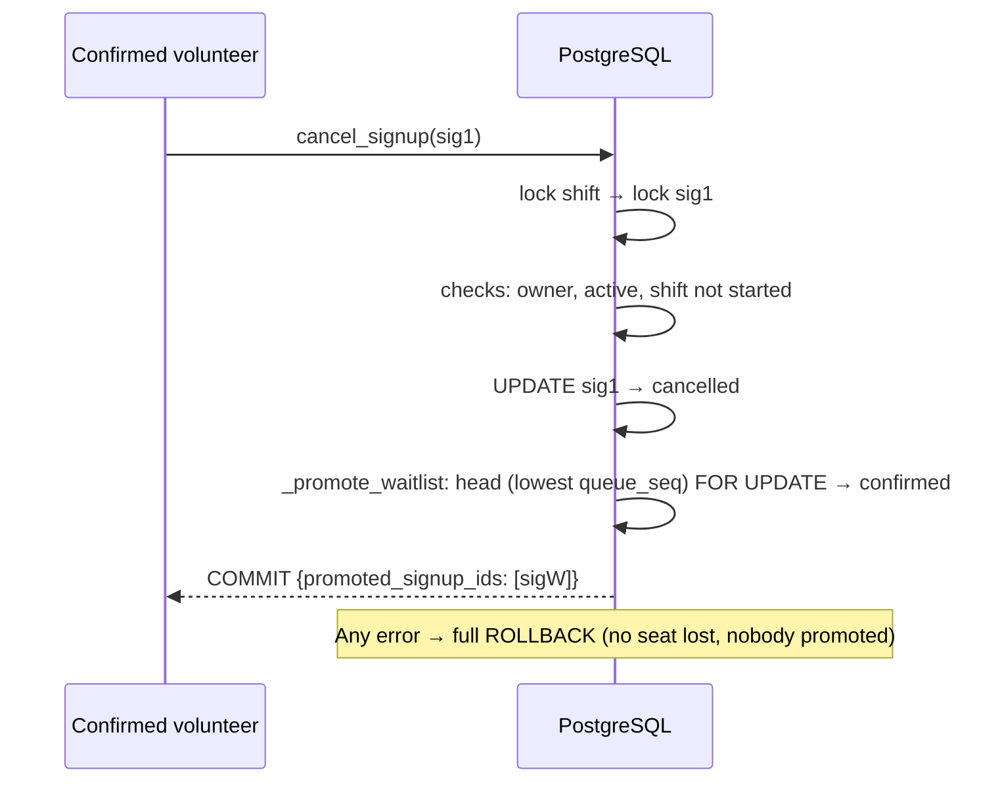
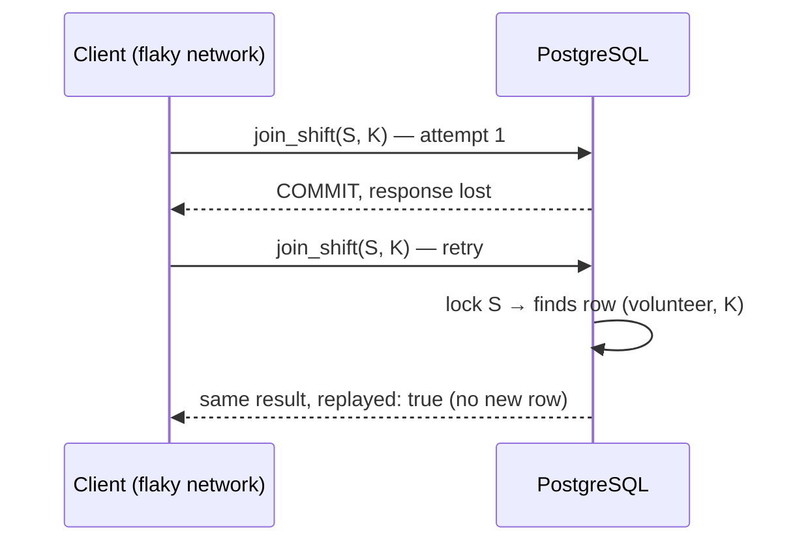

# Worldkin Roster — Database Architecture (Phase 1A)

> **Status:** DESIGN DRAFT for owner review. **Nothing in this document has been applied to any database.**
> **Target:** Supabase project `worldkin-roster` (ref `ekkvwgohpzliwbmjnrth`, `ap-southeast-1`, PostgreSQL 17) — and no other project.
> **Migration drafts:** [`supabase/migrations/`](../../supabase/migrations/)

| File | Contents |
|---|---|
| `20261124194202_wk01_types_tables.sql` | `btree_gist`, enum types, 9 tables, constraints, indexes |
| `20261124194253_wk02_helpers_triggers.sql` | RLS helper functions, guard triggers, append-only triggers, audit trigger, new-user trigger |
| `20261124194325_wk03_rls_grants.sql` | RLS on every table, column-level grants, policies |
| `20261124194532_wk04_rpc.sql` | 16 RPC / internal functions, function grants |

Verification so far (see [`PRE_MIGRATION_AUDIT.md`](PRE_MIGRATION_AUDIT.md)): parser check (138 statements, 19 PL/pgSQL bodies) **and** real execution on a throwaway local PostgreSQL 17.5 (PGlite) with a Supabase-like stub: clean apply + 96/96 behavioural tests. True multi-connection concurrency and Supabase-specific privileges are verified only after the owner approves applying to `worldkin-roster`.

---

## 1. Scope decisions

| Proposed entity | Decision | Reason |
|---|---|---|
| Organizations | **Keep** | Core: verification gate, data isolation boundary |
| Profiles | **Keep** | 1:1 with `auth.users`; holds platform role |
| Organization membership | **Add** (`org_members` + `org_invites`) | A person can work for several orgs with different roles; roles belong to the *membership*, not the person |
| Volunteer skills | **Merge into `profiles.skills text[]`** | A separate table + join table costs time and earns no extra marks; array supports display and filtering. Upgrade path is documented |
| Opportunities | **Keep** | The public "need" with cause, mode, location |
| Shifts | **Keep** | The unit of capacity (A05) |
| Signups | **Keep** | Confirmed / waitlisted / cancelled / attended / no-show lifecycle |
| Attendance | **Merged into signup status** + `participation_records` | Attendance outcome is a signup state; verified hours are a separate *immutable* record |
| Audit logs | **Keep** | A03 audit trail |
| Notifications, messaging, certificates, geo-location, skills taxonomy | **Excluded** | Future scope |

**Final MVP: 9 tables.** (`org_invites` added in the security review to remove a user-enumeration oracle.)

## 2. Entity-relationship diagram



## 3. Table specification

### 3.1 `profiles`
| Column | Type | Rules |
|---|---|---|
| `id` | uuid PK | FK → `auth.users(id)` ON DELETE CASCADE |
| `full_name` | text | NOT NULL, trimmed length 1–120 |
| `country_code` | text | ISO-3166 alpha-2 (`^[A-Z]{2}$`) |
| `city` | text | ≤ 80 chars (coarse location only — no street address is stored anywhere) |
| `bio` | text | ≤ 1000 |
| `skills` | text[] | ≤ 20 items |
| `platform_role` | enum | default `volunteer`; **not writable by API roles** |
| `created_at`, `updated_at` | timestamptz | trigger-maintained |

### 3.2 `organizations`
`id` PK · `name` (2–120) · `slug` UNIQUE, kebab-case 3–60 · `description` ≤ 2000 · `cause` enum · `country_code` NOT NULL · `website` must be `http(s)://` · `status` default `pending` · `status_reason` · `reviewed_by` FK profiles · `reviewed_at` · `created_by` FK profiles (default `auth.uid()`).

### 3.3 `org_members`
PK (`org_id`, `user_id`) · `role` enum (`org_admin`, `coordinator`) · `added_by` · index on `user_id`.

### 3.4 `opportunities`
`id` PK · `org_id` FK · `title` 3–140 · `description` 10–5000 · `cause` · `mode` · `country_code`, `city` · `is_sensitive` · `skills_wanted` ≤ 20 · `requirements` (eligibility notes ≤ 1000) · `requires_skill_match` (if true, `join_shift` admits only volunteers listing ≥ 1 wanted skill; requires non-empty `skills_wanted`) · `status` (draft/published/closed) · `published_at` (set by trigger) · `created_by` (default `auth.uid()`) · `search_vector` (generated, GIN-indexed).
Constraints: UNIQUE (`id`, `org_id`) as composite-FK target; `mode = 'remote' OR country_code IS NOT NULL`.

### 3.5 `shifts`
`id` PK · (`opportunity_id`, `org_id`) composite FK → `opportunities(id, org_id)` · `starts_at`, `ends_at` · `capacity` 1–500 · `waitlist_limit` 0–500 (default 10) · `status` · `cancelled_reason`.
Constraints: `ends_at > starts_at`; duration ≤ 24 h; UNIQUE (`id`, `org_id`).

### 3.6 `signups`
`id` PK · `queue_seq` identity · (`shift_id`, `org_id`) composite FK → `shifts(id, org_id)` · `volunteer_id` FK · `status` · `slot tstzrange` · `idempotency_key` · `promoted_at` · `cancelled_at/by/reason` · `attendance_recorded_at/by`.

| Constraint | Guarantees |
|---|---|
| `signups_one_active_per_shift` (partial UNIQUE where `status <> 'cancelled'`) | A volunteer holds at most one active place per shift |
| `signups_idempotency_key` UNIQUE (`volunteer_id`, `idempotency_key`) | A retried request cannot create a second row |
| `signups_no_overlap` EXCLUDE USING gist (`volunteer_id =`, `slot &&`) WHERE status ∈ {confirmed, waitlisted, attended} | A volunteer can never hold two overlapping places — even under concurrent requests for *different* shifts |
| `signups_cancel_consistency` | `cancelled_at` is set **iff** status = cancelled |

### 3.7 `participation_records`
`signup_id` UNIQUE FK · `shift_id`, `org_id`, `volunteer_id` · `hours numeric(5,2)` with 0 < h ≤ 24 · `verified_by` · `verified_at` · `note`.
`CHECK (verified_by <> volunteer_id)` — self-verification is impossible at the database level. Append-only (UPDATE/DELETE/TRUNCATE blocked by trigger).

### 3.8 `audit_logs`
`id` identity · `occurred_at` · `actor_id` (no FK, so history survives user deletion) · `org_id` · `action` (insert/update/delete) · `entity_type` · `entity_id` · `details jsonb` (full row for insert/delete; `{field: {from, to}}` for updates). Append-only.

### 3.9 Index plan
| Index | Serves |
|---|---|
| `org_members_user_id_idx` | "which orgs am I in" (every RLS helper) |
| `opportunities_status_cause_idx`, `opportunities_search_idx` (GIN) | discovery filters and full-text search |
| `shifts_opportunity_starts_idx`, `shifts_org_starts_idx` | shift lists, dashboards |
| `signups_shift_status_seq_idx` | seat counts and FIFO waitlist under the lock |
| `signups_volunteer_status_idx` | "my shifts", overlap pre-check |
| `participation_volunteer_idx`, `participation_org_idx` | impact and dashboard aggregation |
| `audit_logs_org_time_idx`, `audit_logs_entity_idx` | audit viewer |

## 4. Key design questions

**Volunteer identity and membership.** Every authenticated user has exactly one `profiles` row, created by a trigger on `auth.users`. Everybody is a volunteer; organizational power comes only from rows in `org_members`, scoped to one organization. Platform-wide power (`platform_admin`) is a separate column that no API role can write; the first platform admin is assigned out-of-band by the owner (documented bootstrap step).

**Organization verification.** `create_organization` creates the org as `pending` and makes the creator `org_admin` in one transaction. Only `review_organization` (platform admin, not a member of that org) moves it through the state machine:


Unverified or suspended orgs cannot publish (trigger) and their shifts cannot be joined (RPC check); their content disappears from public listings (RLS).

**Capacity and waitlist.** Decided inside `join_shift` while holding `SELECT … FOR UPDATE` on the shift row. Confirmed if `confirmed < capacity`, else waitlisted if `waitlisted < waitlist_limit`, else `WK_SHIFT_FULL`. Waitlist order is `queue_seq` (assigned while the lock is held, therefore strictly FIFO).

**Overlap prevention.** Two layers: a friendly pre-check inside `join_shift`, and the `signups_no_overlap` exclusion constraint as the guarantee. Shift times are frozen once any active signup exists, so the copied `slot` never goes stale.

**Attendance and hours.** Only `record_attendance` writes them: staff of the owning org only; never your own signup; only after the shift has started and within 7 days after it ends; only once; hours > 0 and ≤ shift duration. The resulting `participation_records` row cannot be edited or deleted by anyone through the API or the RPCs.

**Organization isolation.** Every org-owned table carries `org_id`; composite foreign keys make it impossible for a shift or signup to claim a different `org_id` than its parent. RLS limits staff to rows where `is_org_member(org_id)`.

## 5. Authorization model (A03)

### 5.1 Roles
| Role | Source | Can |
|---|---|---|
| Anonymous (`anon`) | no session | browse verified orgs, public non-sensitive opportunities and shifts, search |
| Volunteer | any signed-in user | edit own profile; join/cancel own signups; see own signups and hours |
| Coordinator | `org_members.role = coordinator` | manage that org's opportunities and shifts; roster; attendance |
| Org admin | `org_members.role = org_admin` | coordinator rights + edit org profile, manage members, read org audit log |
| Platform admin | `profiles.platform_role` | review organizations; read everything; read full audit log |

### 5.2 Privilege layers
1. **Column grants** — API roles get `SELECT` on readable tables and `INSERT/UPDATE` only on safe columns. Not grantable to clients: `profiles.platform_role`, `organizations.status/reviewed_*`, `shifts.capacity` (update) and `shifts.status`, all of `signups`, `participation_records`, `audit_logs`, `org_members`.
2. **RLS** — row visibility and ownership (matrix below).
3. **SECURITY DEFINER RPCs** — the only write path for protected state; each re-checks identity and role.
4. **Triggers** — invariants that hold even for RPCs (append-only tables, opportunity lifecycle, shift time freeze, role-change guard).
5. **Constraints** — last line of defence (self-verification CHECK, exclusion, unique, composite FKs).

### 5.3 RLS policy matrix
| Table | SELECT | INSERT | UPDATE | DELETE |
|---|---|---|---|---|
| profiles | self · co-members of an org · platform admin | — (trigger) | self, safe columns only | — |
| organizations | `verified` (anyone) · members · platform admin | — (RPC) | org admin, descriptive columns | — |
| org_members | members of same org · platform admin | — (RPC) | — | — (RPC) |
| org_invites | org admin of that org · platform admin (invitees use `my_org_invites` RPC) | — (RPC) | — (RPC) | — |
| opportunities | public rule¹ · org members · platform admin | org members | org members (lifecycle trigger) | — |
| shifts | public rule¹ · org members · platform admin | org members | org members (title/time/waitlist only) | — |
| signups | own · org members · platform admin | — (RPC) | — (RPC) | — |
| participation_records | own · org members · platform admin | — (RPC) | — (blocked) | — (blocked) |
| audit_logs | platform admin · org admin of `org_id` | — (trigger) | — (blocked) | — (blocked) |

¹ *Public rule* (`is_opportunity_public`): opportunity `published` AND organization `verified` AND (not `is_sensitive` OR caller signed in).

## 6. RPC specification

All RPCs: `SECURITY DEFINER`, `search_path = ''`, one transaction per call, errors raised as `WK_*` codes.

| Function | Caller | Purpose / rules | Returns |
|---|---|---|---|
| `join_shift(shift_id, idempotency_key)` | signed-in | lock shift → idempotent replay → eligibility (org verified, opp published, shift scheduled, not started, skill match if required) → duplicate → overlap → capacity/waitlist → insert | `{signup_id, status, waitlist_position, replayed}` |
| `cancel_signup(signup_id, reason?)` | volunteer (own) or staff (reason required) | before shift start; promotes waitlist head if a confirmed seat was freed; repeat call is a no-op | `{status, promoted_signup_ids, replayed}` |
| `update_shift_capacity(shift_id, capacity)` | staff | not below confirmed count; increase promotes waitlist | `{capacity, confirmed, promoted_signup_ids}` |
| `cancel_shift(shift_id, reason)` | staff | cancels shift + all active signups atomically | `{cancelled_signups}` |
| `record_attendance(signup_id, attended, hours?, note?)` | staff, not self | after start, ≤ 7 days after end, once, 0 < hours ≤ duration | `{status, hours}` |
| `create_organization(...)` | signed-in | org `pending` + creator `org_admin`; max 3 pending per user | `org_id` |
| `review_organization(org_id, decision, reason?)` | platform admin, not a member | state machine above; reason required for reject/suspend | `{from, to}` |
| `invite_org_member(org_id, email, role)` | org admin of a **verified** org | records an invite; never reads `auth.users` or `org_members`, so the response is identical for registered and unregistered emails; ≤ 50 open invites per org; duplicate open invite → `WK_ALREADY_INVITED` | `{invite_id, status: invited}` |
| `my_org_invites()` | signed-in, **confirmed** email | open, unexpired invites for the caller's own email | rows |
| `accept_org_invite(invite_id)` | the invitee (confirmed email must match) | adds membership; repeat is a no-op; other users get `WK_INVITE_NOT_FOUND` | `{org_id, role, already_member}` |
| `revoke_org_invite(invite_id)` | org admin | withdraws an open invite | `{status}` |
| `remove_org_member(org_id, user_id)` | org admin | cannot remove the last org admin (org row locked) | `{removed}` |
| `search_opportunities(query, cause, country, mode, starts_after, only_open, sort, limit, offset)` | anyone | public rows only; full-text + filters; sorts `soonest/newest/most_open/relevance`; limit clamped to 50 | rows + `total_count` |
| `shift_availability(opportunity_id)` | anyone (visibility-checked) | seat counts, never identities; caller's own status | rows |
| `get_shift_roster(shift_id)` | staff / platform admin | name, skills, status, waitlist position, hours — no email or location | rows |
| `org_dashboard(org_id)` | staff / platform admin | opportunity counts, upcoming capacity/confirmed/waitlisted, fill rate %, verified hours, unique volunteers, no-show rate % | jsonb |
| `my_impact()` | signed-in | verified hours, shifts attended, upcoming, waitlisted, orgs helped, hours by cause | jsonb |
| `_signup_result`, `_promote_waitlist` | **internal only** | not executable by API roles | — |

### Error codes
`WK_AUTH_REQUIRED`, `WK_INVALID_INPUT`, `WK_FORBIDDEN`, `WK_SHIFT_NOT_FOUND`, `WK_SHIFT_NOT_OPEN`, `WK_SHIFT_CANCELLED`, `WK_SHIFT_STARTED`, `WK_SHIFT_NOT_STARTED`, `WK_SHIFT_FULL`, `WK_NOT_ELIGIBLE`, `WK_ALREADY_SIGNED_UP`, `WK_DUPLICATE_REQUEST`, `WK_IDEMPOTENCY_KEY_REUSED`, `WK_SCHEDULE_CONFLICT`, `WK_CAPACITY_BELOW_CONFIRMED`, `WK_SIGNUP_NOT_FOUND`, `WK_INVALID_STATE`, `WK_REASON_REQUIRED`, `WK_SELF_VERIFICATION`, `WK_ALREADY_RECORDED`, `WK_ATTENDANCE_WINDOW_CLOSED`, `WK_INVALID_HOURS`, `WK_ORG_NOT_FOUND`, `WK_ORG_NOT_VERIFIED`, `WK_CONFLICT_OF_INTEREST`, `WK_INVALID_TRANSITION`, `WK_SLUG_TAKEN`, `WK_TOO_MANY_PENDING_ORGS`, `WK_ALREADY_INVITED`, `WK_TOO_MANY_INVITES`, `WK_INVITE_NOT_FOUND`, `WK_MEMBER_NOT_FOUND`, `WK_LAST_ADMIN`, `WK_FORBIDDEN_ROLE_CHANGE`, `WK_IMMUTABLE_FIELD`, `WK_APPEND_ONLY`, `WK_SHIFT_IN_PAST`, `WK_SHIFT_HAS_SIGNUPS`, `WK_OPPORTUNITY_CLOSED`.

## 7. Transaction flows (A05)

### 7.1 Two volunteers race for the last seat


### 7.2 Cancellation with waitlist promotion


### 7.3 Duplicate / retried request (idempotency)


### 7.4 Overlap race on two different shifts
Volunteer V requests shifts S1 and S2 (overlapping) at the same instant. The two calls lock *different* shift rows, so both pass the pre-check. The second INSERT waits on the exclusion constraint until the first commits, then fails with `exclusion_violation`, which `join_shift` maps to `WK_SCHEDULE_CONFLICT`. Exactly one place survives.

### 7.5 Capacity change
`update_shift_capacity` locks the shift, rejects a value below the confirmed count, updates capacity, and (if raised) promotes from the waitlist — all in one transaction.

## 8. Threat model

| ID | Threat | Vector | Control(s) | Test |
|---|---|---|---|---|
| T1 | Self role escalation | `PATCH profiles {platform_role}` / signup metadata | no column grant; `tg_profiles_guard`; trigger ignores metadata role | S2, S3 |
| T2 | Cross-organization access | coordinator queries/updates another org's rows | RLS `is_org_member(org_id)`; composite FKs | S4, S5 |
| T3 | Self-verified hours | staff records own attendance | RPC check + `CHECK (verified_by <> volunteer_id)` | S6 |
| T4 | Tampering with hours | UPDATE/DELETE participation record | no grants + append-only trigger | S7 |
| T5 | Audit-log tampering | UPDATE/DELETE/TRUNCATE audit_logs | no grants + append-only triggers | S8 |
| T6 | Bypassing capacity | direct INSERT into signups | no INSERT grant/policy; RPC only | S9 |
| T7 | Unverified/fake organization recruiting | publish before verification | publish trigger + join check + RLS | S10 |
| T8 | Privacy leak of volunteers | read other volunteers' profiles/signups | RLS; roster RPC returns name+skills only; no email/address exposed | S11 |
| T9 | Search-path hijack of definer functions | malicious object in another schema | `search_path = ''`, schema-qualified names | review |
| T10 | Calling internal functions | `rpc/_promote_waitlist` | EXECUTE revoked | S12 |
| T11 | Sensitive (conflict-zone) opportunity exposure | anonymous scraping | hidden from `anon` by RLS/search | S13 |
| T12 | Platform admin conflict of interest | admin verifies own org | `WK_CONFLICT_OF_INTEREST` | S14 |
| T13 | Organization left without admin | concurrent member removals | org row lock + last-admin rule | S15 |
| T14 | User enumeration (is this email registered?) | org admin adds arbitrary emails | invite flow never touches `auth.users`; identical responses; membership only after the invitee accepts | ENUM, ENUM2, ENUM3, security_focus E1–E7 |
| T15 | Forging the operator path to create past shifts | clearing request claims inside an API session | `_is_api_request()` keys on `session_user = authenticator` (unforgeable without superuser) | security_focus P1–P6, T1–T4, O1 |

**Operational decisions**
| Topic | Decision |
|---|---|
| Platform governance | Multiple platform admins are supported (no database limit). Role changes have **no API path** for anyone, admins included; they are performed only by the Founder through an operator session with the guarded procedures below, and are audited. See "Platform governance" below. |
| Wrong attendance | No correction in the MVP. Records are append-only even for RPCs. An operator correction would require the table owner to disable the trigger — a deliberate, visible action. Future: append-only "adjustment" records. Documented as a known limitation in README, `docs/ARCHITECTURE.md` and the demo script (the coordinator UI will show a confirm dialog: "Attendance cannot be changed after saving"). |
| Email confirmation | **Kept ON** (Supabase default). Production auth is not weakened for the demo. Judges receive pre-confirmed demo accounts privately (allowed by the official rules). Demo/test users are created pre-confirmed through the Auth Admin API from a one-off local script, with the secret key supplied by the owner only as a terminal environment variable for that session (never written to disk or the repo), or by the owner via Dashboard → Add user → Auto-confirm. Known constraint (Supabase docs, not yet verified on this project): the built-in email service is rate-limited and may only deliver to project team members until custom SMTP is configured, so open self-registration may not receive confirmation mails; custom SMTP is a separate, optional decision. |
| Sensitive opportunities | `is_sensitive` hides them from anonymous visitors (RLS + search); only city-level location is ever stored; rosters show name + skills only. Not a substitute for field-safety vetting. |
| Suspension | `review_organization(org, 'suspended', reason)`: org and its content disappear from public views, new joins are rejected, staff keep access to history; `suspended → verified` restores. |
| Account deletion | Users with signups / records / created content cannot be hard-deleted (FK `restrict` preserves history; delete fails). Deactivation = Supabase Auth ban (no DB change). Users without history can be deleted; their profile cascades. |
| Historical demo data | Only operator sessions (direct owner-role DB session: Supabase SQL Editor / MCP / psql) may insert past shifts for seeding. `_is_api_request()` treats a session as API if it logged in as `authenticator` (PostgREST), runs as an API role, or carries request claims; API callers never can. |

**Platform governance (MVP — Option A, no schema change)**

| Role | Who | How granted / revoked |
|---|---|---|
| Founder / Primary Owner | the project owner's account (identified privately; the email is never written to the repository) | an operational designation, not a database role: the Founder is a `platform_admin` **and** the only person with Supabase Dashboard / database credentials for `worldkin-roster` |
| Platform admin (several allowed, e.g. 4–5) | trusted operators named by the Founder | guarded operator SQL below, one account per approved run |
| Org admin / coordinator (several per org) | organization staff | consent-based invites (`invite_org_member` → `accept_org_invite`), `remove_org_member` (last-admin protected) |
| Volunteer | everyone else; may join shifts of any organization | default at sign-up |

Founder protection rests on infrastructure access control plus the database rules that already exist: no API role can write `platform_role` (column privilege + `tg_profiles_guard`), so no admin can promote, demote or remove the Founder or anyone else; only an operator session can, and every change is written to the append-only `audit_logs`. The `service_role` key can also change roles and is therefore treated as an operator credential (server-side only, never in the browser or the repository). Keeping the number of admins small limits who can read cross-organization data.

**Provisioning a platform admin (owner-approved, one account per run)**
1. The account exists, has a confirmed email, and is not deleted.
2. Pre-check: project ref = `ekkvwgohpzliwbmjnrth`; exactly one `auth.users` row matches the email (case-insensitive); current role is `volunteer`; the account has no `org_members` rows.
3. Operator SQL (one statement; affects at most one row; no "only one admin" condition):
   ```sql
   with target as (
     select u.id
     from auth.users u
     where lower(u.email) = lower('<admin email>')
       and u.email_confirmed_at is not null
       and u.deleted_at is null
   )
   update public.profiles p
      set platform_role = 'platform_admin'
     from target t
    where p.id = t.id
      and p.platform_role = 'volunteer'
      and (select count(*) from target) = 1
      and not exists (select 1 from public.org_members m where m.user_id = t.id)
   returning p.id, p.platform_role;
   ```
   Expect exactly 1 row; 0 rows means a guard failed (stop and investigate). Re-running for an existing admin returns 0 rows (idempotent).
4. Verify: a new `audit_logs` row (`entity_type = 'profiles'`, `action = 'update'`, `actor_id is null`, `details.platform_role` = volunteer → platform_admin) and, via the API, `rpc/is_platform_admin` returns `true` for that account.
5. Rule: a platform admin must not be a member of any organization it may review (otherwise `WK_CONFLICT_OF_INTEREST`).

**Revoking a platform admin (owner-approved)**
```sql
update public.profiles p
   set platform_role = 'volunteer'
  from auth.users u
 where u.id = p.id
   and lower(u.email) = lower('<admin email>')
   and lower(u.email) <> lower('<founder email>')   -- the Founder can never be revoked by this template
   and p.platform_role = 'platform_admin'
returning p.id, p.platform_role;
```
Revocation takes effect on the next request (`is_platform_admin()` reads the table each time; no privilege is cached in tokens). Both grant and revoke remain in the audit log.

**Audit limitation (Option A):** operator role changes are recorded with `actor_id = null` ("operator action"); which operator ran them is established by the Founder's operational record and the Supabase platform logs, not by `audit_logs`. Future (P2, Option B): a `platform_owner` role with owner-only `grant/revoke_platform_admin` RPCs recording the acting user's ID.

**Known limitations (stated honestly):** rejected attempts are not written to `audit_logs` (the transaction rolls back; Supabase API logs still record the request). The MVP has no correction workflow for a mistaken participation record. `is_sensitive` hides content from anonymous visitors but is not a substitute for real field-safety vetting.

## 9. Test scenarios

### A05 — Concurrency & transactions
| ID | Scenario | Expected (acceptance criterion) |
|---|---|---|
| C1 | 20 volunteers call `join_shift` concurrently on capacity 1, waitlist 5 | exactly 1 `confirmed`, 5 `waitlisted` (positions 1–5, no gaps), 14 `WK_SHIFT_FULL`; repeatable over runs |
| C2 | Same volunteer, same idempotency key, 5 concurrent calls | exactly 1 row; 1 `replayed:false`, 4 `replayed:true` with the same `signup_id` |
| C3 | Same volunteer, two overlapping shifts, concurrent | exactly 1 succeeds; other `WK_SCHEDULE_CONFLICT` |
| C4 | Confirmed volunteer cancels while shift has waitlist | waitlist position 1 becomes `confirmed` with `promoted_at`; positions shift up |
| C5 | Two confirmed volunteers cancel concurrently with 2 waitlisted | both waitlisted promoted, confirmed = capacity, never above |
| C6 | Capacity 5 → 3 with 4 confirmed | `WK_CAPACITY_BELOW_CONFIRMED`, nothing changes |
| C7 | Capacity 2 → 4 with 3 waitlisted | first 2 waitlisted promoted in FIFO order |
| C8 | Error after partial work (e.g. invalid hours in `record_attendance`) | signup status unchanged (rollback proven) |
| C9 | Concurrent join + cancel + capacity change storm | invariant holds: confirmed ≤ capacity, waitlisted ≤ waitlist_limit |
| C10 | Join after start / cancelled shift / closed opportunity | `WK_SHIFT_STARTED` / `WK_SHIFT_CANCELLED` / `WK_SHIFT_NOT_OPEN` |
| C11 | Volunteer without a wanted skill joins a `requires_skill_match` opportunity | `WK_NOT_ELIGIBLE`; after adding a matching skill (any letter case) the join succeeds |

### A03 — Security & access control
| ID | Scenario | Expected |
|---|---|---|
| S1 | Anonymous reads signups / profiles / audit_logs | empty or permission denied |
| S2 | Volunteer `PATCH profiles set platform_role=platform_admin` | permission denied (column) |
| S3 | Sign-up with metadata `{"platform_role":"platform_admin"}` | profile created as `volunteer` |
| S4 | Coordinator of Org A selects Org B signups/rosters | 0 rows / `WK_SHIFT_NOT_FOUND` |
| S5 | Coordinator of Org A updates Org B shift / inserts shift with Org B `org_id` | 0 rows / RLS violation |
| S6 | Coordinator records own attendance | `WK_SELF_VERIFICATION` |
| S7 | Anyone updates/deletes a participation record | denied (`WK_APPEND_ONLY` / no privilege) |
| S8 | Org admin / platform admin updates or deletes audit log | denied |
| S9 | Volunteer inserts into `signups` directly | permission denied |
| S10 | Pending org publishes an opportunity | `WK_ORG_NOT_VERIFIED` |
| S11 | Volunteer A reads Volunteer B's signups/profile | 0 rows |
| S12 | Client calls `_promote_waitlist` | permission denied |
| S13 | Anonymous search for sensitive opportunity | not returned; signed-in user sees it |
| S14 | Platform admin who is org member reviews that org | `WK_CONFLICT_OF_INTEREST` |
| S15 | Remove the last org admin | `WK_LAST_ADMIN` |
| S16 | Every successful state change | matching `audit_logs` row with correct actor and org |

### M04/M05/M06 extras
Opportunity lifecycle transitions (draft→published→closed; closed→published rejected); shift time edit after signups (`WK_SHIFT_HAS_SIGNUPS`); search with malformed query text (no error); pagination `total_count`; dashboard fill-rate and no-show-rate arithmetic checked against hand-computed fixtures.

**How tests will run (after approval):** a Node test script using `@supabase/supabase-js` with several real test users (volunteers, coordinators of two orgs, a platform admin) against the Worldkin project only; concurrency via `Promise.all` of parallel RPC calls; results recorded in `docs/TESTING.md`.

## 10. Bootstrap steps (after approval, not yet performed)
1. Apply migrations 01→04 to `ekkvwgohpzliwbmjnrth` only.
2. Run Supabase security/performance advisors; fix findings.
3. Create test users; promote one to `platform_admin` via SQL (owner-approved, documented).
4. Seed demo organizations, opportunities and shifts.
5. Run the A03/A05 test suite and record evidence.

## 11. Applications platform (migration wk06/wk07, 26 Nov 2026)

Design rationale: `docs/DESIGN_DECISIONS.md`. Additive only; existing data untouched.

| Object | Purpose | Access |
|---|---|---|
| `opportunities` + `compensation_type` (voluntary/stipend/paid), `compensation_details` (required unless voluntary), `selection_mode` (open/application), `application_deadline`, `moderation_*` | public listing data | existing RLS; moderation columns not client-writable |
| `profiles` + education, interests, languages, availability, experience, avatar_url, suspended_* | richer volunteer profile; suspension | suspension columns not client-writable |
| `profile_private(phone)` | private contact | owner + platform admin |
| `organizations` + org_type, city, phone, official_email, logo_url | public organization details | existing RLS |
| `organization_private` | address, registration ID, representative, document paths | org members read, org admins write, platform admins read |
| `applications` | one active per volunteer per opportunity (partial unique) | own / org members / platform admin; writes via RPC only |
| `application_notes` | internal review notes | org members only |
| `offers` | 72-hour offers for a specific shift; one pending per application; accepted ⇒ signup | own / org members / platform admin; RPC only |
| `complaints` | private reports | reporter + platform admin; not audited under org_id (no leak to the organization) |
| `feedback` | one per verified participation; moderated | author + platform admin; public via `org_feedback()` (first name only) |
| `notifications` | written only by server functions | own; only `read_at` writable |

**RPCs:** `apply_to_opportunity`, `withdraw_application`, `review_application`, `send_offer`, `revoke_offer`, `accept_offer`, `decline_offer`, `my_applications`, `org_applications`, `my_participation`, `submit_feedback`, `org_feedback`, `moderate_feedback`, `submit_complaint`, `respond_complaint`, `admin_set_suspension`, `admin_users`, `admin_moderate_opportunity`, `admin_overview`, `platform_stats`, `list_organizations`; `search_opportunities` and `create_organization` extended. Internal: `_join_shift_core` (booking core shared by `join_shift` and `accept_offer`), `_expire_offers` (SKIP LOCKED), `_notify`, `_notify_org_admins`, `_assert_active`.

**Lock order:** volunteer profile → application → offer → shift → signup. Org-side actions take application → offer; list reads expire offers with SKIP LOCKED, so they never wait on a decision in progress.

**Storage (wk07):** `avatars` (public; write only into one's own or one's administered organization's folder) and `org-docs` (private; org admins upload, org members and platform admins read through short-lived signed URLs; no delete).
